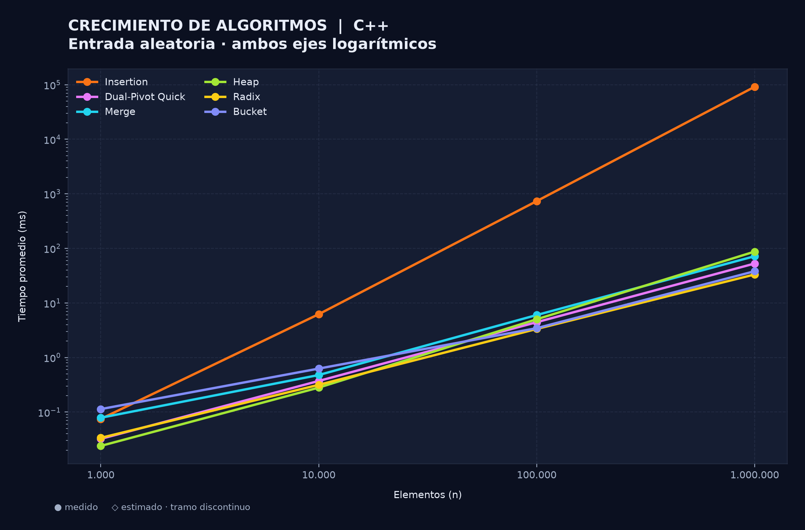
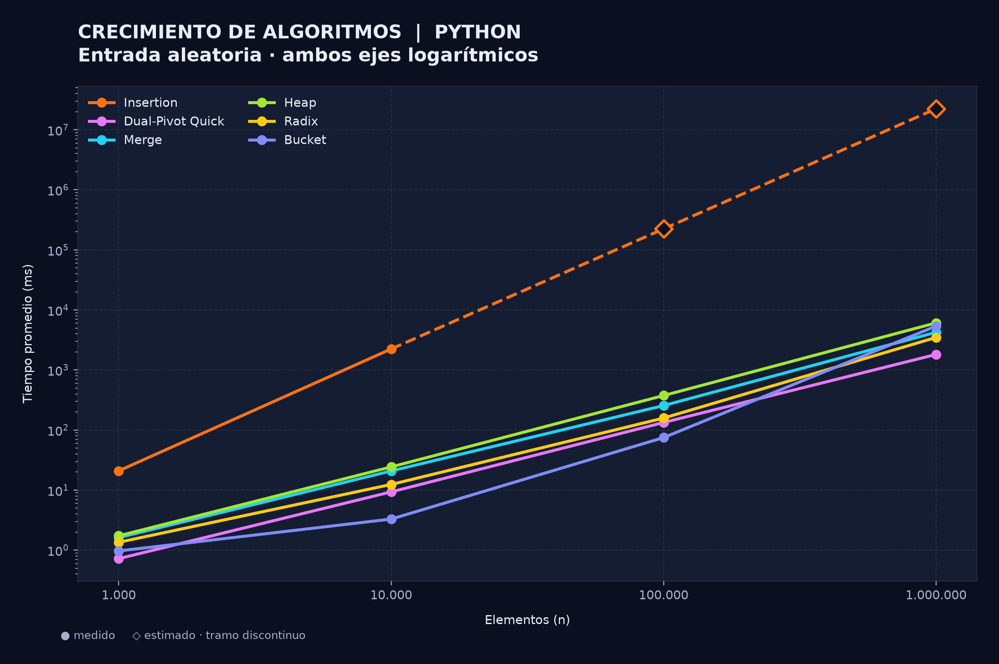
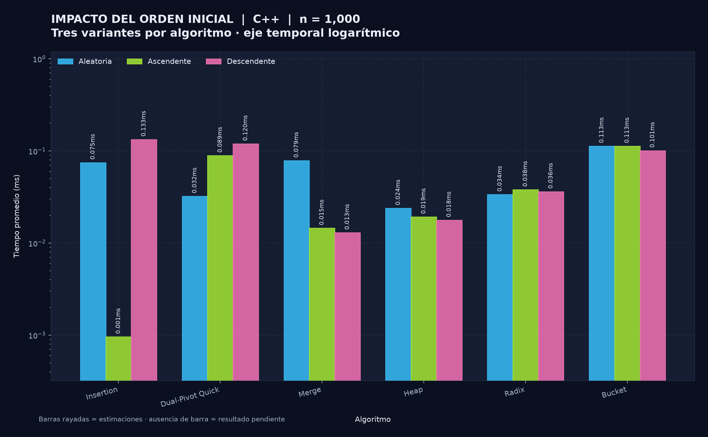
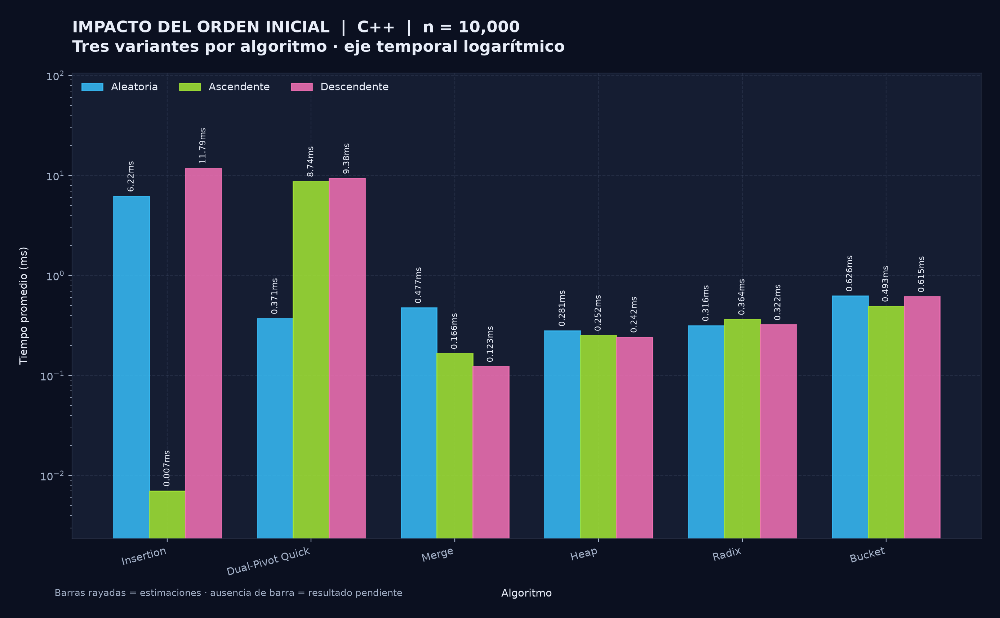
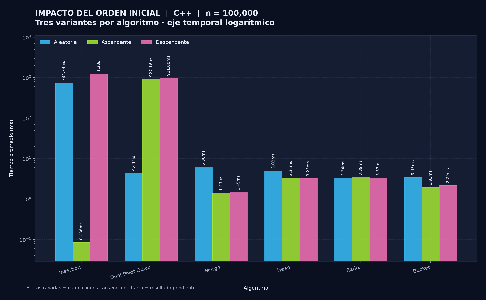
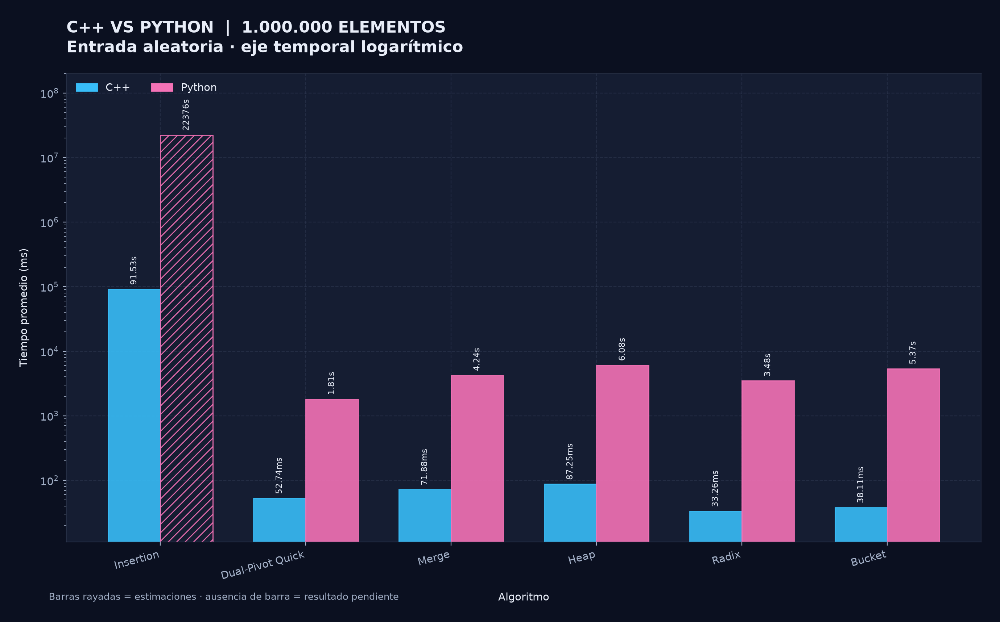

# Punto 1 Comparación experimental de algoritmos de ordenamiento

## 1 Objetivo y acceso al proyecto

Se comparó el desempeño de Insertion Sort, Dual-Pivot QuickSort, Merge Sort, Heap Sort, Radix Sort y Bucket Sort en C++ y Python. El propósito fue observar cómo cambia el tiempo al aumentar el número de elementos, modificar su orden inicial y ejecutar la misma estrategia de ordenamiento en dos lenguajes. Los resultados muestran que la complejidad teórica permite interpretar las tendencias, aunque no determina por sí sola el tiempo ni qué implementación será la más rápida en cada lenguaje.

**Repositorio del código:** https://github.com/Estebangmz666/sorting-algorithms-benchmark

**Dashboard interactivo:** https://estebangmz666.github.io/ordenamiento/

## 2 Metodología y decisiones técnicas

### 2.1 Datos y condiciones de medición

Se utilizaron arreglos de 1.000, 10.000, 100.000 y 1.000.000 de enteros entre 10.000.000 y 99.999.999. Para cada tamaño se conservaron tres archivos con los mismos elementos: aleatorio, ascendente y descendente. Los algoritmos de ambos lenguajes leen esos archivos, por lo que la comparación de una misma combinación no cambia el conjunto de entrada.

Cada combinación medida se ejecutó cinco veces sobre una copia nueva del arreglo original. C++ utiliza `std::chrono::steady_clock` y Python, `time.perf_counter_ns()`. La lectura del archivo, la preparación de la copia y la verificación se realizan fuera del intervalo cronometrado. La verificación compara la salida completa con `std::sort` o `sorted`, según el lenguaje, para comprobar tanto el orden como la conservación de los elementos.

Se reportan la media de los cinco tiempos y la desviación estándar muestral, cuyo denominador es 5 − 1. Esta desviación describe la dispersión de ejecuciones sobre el mismo archivo; no representa un intervalo de confianza ni la variabilidad entre diferentes conjuntos aleatorios. El coordinador inicia un proceso por repetición y registra sus resultados en CSV. Las asignaciones y operaciones auxiliares que forman parte de la función de ordenamiento sí quedan dentro de su tiempo.

Los dos CSV contienen las 144 combinaciones previstas: 6 algoritmos × 2 lenguajes × 3 variantes × 4 tamaños. De ellas, 138 son medidas y aportan 690 tiempos individuales; las seis restantes son estimaciones de Python. Se comprobó la cobertura, la ausencia de claves duplicadas y la coincidencia de medias y desviaciones con las repeticiones registradas.

### 2.2 Decisiones de implementación

En Dual-Pivot QuickSort se usan los elementos de los extremos como pivotes, como solicita el taller. Los subarreglos pendientes se administran con una pila explícita. Así se conserva el particionado sin depender de llamadas recursivas profundas, aunque el orden inicial todavía puede producir particiones desfavorables. La pila requiere memoria adicional variable.

Merge Sort reserva un buffer de tamaño n que reutiliza durante las mezclas. Heap Sort realiza el descenso por el montículo con un ciclo y trabaja sobre el arreglo. Insertion Sort desplaza solo valores estrictamente mayores que la clave, de modo que no cambia el orden relativo de valores iguales.

Radix Sort trabaja en base 10 y realiza ocho pasadas, desde el dígito menos significativo, porque todos los valores tienen ocho dígitos. Cada pasada usa conteos acumulados y una salida auxiliar estable. C++ intercambia los buffers; Python actualiza la lista mediante una copia por slice. Comparten la estrategia, pero esas operaciones no tienen idéntico costo.

Bucket Sort utiliza 4096 cubetas. La asignación se calcula mediante:

`índice = floor((valor − 10.000.000) × 4096 / 90.000.000)`

Esto produce índices entre 0 y 4095. Los valores se incorporan en orden de llegada, se aplica Insertion Sort dentro de cada cubeta y se concatenan las cubetas por índice. El número fijo de cubetas y el algoritmo interno son relevantes para interpretar su crecimiento.

## 3 Complejidad y propiedades de las versiones utilizadas

La tabla resume la teoría de referencia y las particularidades que se deducen del código [1–4]. Se considera costo constante para las operaciones sobre enteros del dominio evaluado. Se usa la definición estricta de *in-place*: memoria auxiliar O(1), sin contar el arreglo original.

| Algoritmo | Mejor caso | Caso promedio | Peor caso | Estable | In-place estricto |
|---|---|---|---|---|---|
| Insertion Sort | Θ(n) | Θ(n²) | Θ(n²) | Sí | Sí |
| Dual-Pivot QuickSort | Θ(n)* | Θ(n log n)** | Θ(n²) | No | No, por la pila variable |
| Merge Sort | Θ(n log n) | Θ(n log n) | Θ(n log n) | Sí | No, buffer Θ(n) |
| Heap Sort | Θ(n)* | Θ(n log n)** | Θ(n log n) | No | Sí |
| Radix Sort LSD | Θ(d(n + b)) | Θ(d(n + b)) | Θ(d(n + b)) | Sí | No, salida Θ(n + b) |
| Bucket Sort con inserción | Θ(n + k) | Θ(n + k + n²/k)*** | Θ(n² + k) | Sí | No, cubetas Θ(n + k) |

\* En estas versiones, todos los valores iguales permiten un mejor caso lineal: Heap Sort termina cada descenso inmediatamente y Dual-Pivot omite el intervalo central cuando los pivotes son iguales. Para claves distintas, el mejor caso de Heap Sort y el particionado balanceado de Dual-Pivot corresponden al orden n log n. Estos casos especiales no describen los archivos aleatorios de la prueba.

\*\* El modelo promedio supone entradas aleatorias apropiadas; para Dual-Pivot, el análisis de referencia considera permutaciones de claves distintas [3]. El promedio teórico sobre entradas no es lo mismo que promediar cinco ejecuciones sobre un mismo archivo.

\*\*\* El promedio de Bucket supone distribución aproximadamente uniforme y orden aleatorio. Con ocupaciones mᵢ, una cota es O(n + k + Σmᵢ²); el orden interno determina cuántos desplazamientos hace Insertion Sort. Como k = 4096 permanece fijo, no se garantiza un promedio asintótico lineal. En cambio, si la entrada es ascendente, las cubetas ya quedan ordenadas y el costo es Θ(n + k). Para Radix, d = 8 y b = 10 son constantes, por lo que su costo es Θ(n) en este dominio.

La estabilidad se deduce de las operaciones del código. Insertion y Bucket no desplazan empates; Merge toma primero el elemento izquierdo al empatar; Radix mantiene el orden en cada pasada [2]. Las mediciones sobre enteros sin etiquetas no comprueban por sí mismas el orden relativo de elementos iguales. Dual-Pivot particiona sobre el arreglo, pero no se clasifica como in-place estricto porque conserva intervalos en una pila.

## 4 Crecimiento con entrada aleatoria

Las figuras 1 y 2 presentan una línea por algoritmo, con ambos ejes logarítmicos. Los puntos estimados aparecen con rombos y tramos discontinuos. Las tablas muestran R = T(10n)/T(n): una referencia lineal predice 10×; una cuadrática, 100×; y n log₂(n) predice 13,33×, 12,50× y 12,00× en los tres intervalos.

### 4.1 Resultados de C++

**Figura 1.** Tiempos promedio de C++ con entrada aleatoria. Todos los puntos son medidos.

| Algoritmo | 1.000 → 10.000 | 10.000 → 100.000 | 100.000 → 1.000.000 |
|---|---|---|---|
| Insertion Sort | 83,01× | 118,17× | 124,57× |
| Dual-Pivot QuickSort | 11,50× | 11,95× | 11,88× |
| Merge Sort | 6,07× | 12,57× | 11,98× |
| Heap Sort | 11,72× | 17,87× | 17,39× |
| Radix Sort | 9,37× | 10,57× | 9,97× |
| Bucket Sort | 5,53× | 5,51× | 11,05× |

Insertion Sort creció 83,01×, 118,17× y 124,57×, una tendencia compatible con trabajo cuadrático, aunque no reproduce exactamente el factor 100. Radix Sort presentó 9,37×, 10,57× y 9,97×, muy próximos al comportamiento lineal esperado para ocho pasadas fijas.

Dual-Pivot QuickSort se mantuvo alrededor de 12× por intervalo. Merge Sort se aproximó a n log n en los dos intervalos mayores; el primero requiere cautela porque su medición de 1.000 elementos tuvo alta dispersión. Heap Sort aumentó más que la referencia n log n en los dos últimos intervalos. Los cocientes observados incluyen las constantes de cada implementación y la variabilidad de ejecución: no son una prueba aislada de la complejidad asintótica.

### 4.2 Resultados de Python

**Figura 2.** Tiempos de Python. Insertion Sort incluye dos puntos estimados en esta variante.

| Algoritmo | 1.000 → 10.000 | 10.000 → 100.000 | 100.000 → 1.000.000 |
|---|---|---|---|
| Insertion Sort | 106,90× | 100,00× E | 100,00× E |
| Dual-Pivot QuickSort | 12,94× | 14,29× | 13,57× |
| Merge Sort | 12,88× | 12,26× | 16,60× |
| Heap Sort | 14,02× | 15,43× | 16,21× |
| Radix Sort | 9,18× | 12,74× | 21,99× |
| Bucket Sort | 3,39× | 22,72× | 71,78× |

**E:** al menos uno de los tiempos del cociente es estimado. Los demás cocientes se calcularon entre promedios medidos.

El crecimiento medido inicial de Insertion Sort fue 106,90×. Sus dos factores posteriores de 100× provienen de la extrapolación cuadrática; su coincidencia con la teoría no constituye una confirmación experimental independiente.

Merge Sort, Heap Sort y Dual-Pivot QuickSort mantuvieron crecimientos menores que el cuadrático. Radix Sort aumentó 21,99× en el último intervalo, frente a la referencia lineal de 10×. Este resultado no modifica el número fijo de pasadas de su código; muestra que el tiempo real no depende únicamente del orden asintótico. Los CSV no permiten atribuir esa diferencia a CPU, caché o memoria.

Bucket Sort pasó de factores de 3,39× y 22,72× a 71,78×. Con 4096 cubetas fijas, al crecer n también crece la ocupación por cubeta y puede aumentar el trabajo de la inserción interna. Esa relación del código ayuda a interpretar el crecimiento más pronunciado en Python. Los tiempos menores incluyen además el costo fijo de preparar miles de cubetas, por lo que no se espera un único factor constante en todos los tamaños.

## 5 Efecto del orden inicial en C++

Las figuras 3, 4 y 5 comparan las tres variantes con los mismos elementos. El eje temporal es logarítmico y cada barra muestra su tiempo.

**Figura 3.** Comparación de entradas aleatorias, ascendentes y descendentes para 1.000 elementos.

**Figura 4.** Comparación de variantes para 10.000 elementos.

**Figura 5.** Comparación de variantes para 100.000 elementos.

La siguiente tabla resume el mayor de los tres tamaños graficados; todos sus tiempos son medidos y están en milisegundos.

| Algoritmo | Aleatoria ms | Ascendente ms | Descendente ms |
|---|---|---|---|
| Insertion Sort | 734,73602 | 0,08638 | 1.230,22682 |
| Dual-Pivot QuickSort | 4,43800 | 927,15818 | 981,79768 |
| Merge Sort | 5,99980 | 1,42960 | 1,44894 |
| Heap Sort | 5,01620 | 3,30900 | 3,25178 |
| Radix Sort | 3,33590 | 3,39414 | 3,37014 |
| Bucket Sort | 3,44766 | 1,92726 | 2,19534 |

Insertion Sort fue especialmente favorable con entrada ascendente: para 100.000 elementos pasó de 734,73602 ms en aleatorio a 0,08638 ms en ascendente. Esto se explica por la ausencia de desplazamientos cuando cada clave ya está en su posición. En descendente obtuvo 1.230,22682 ms, aproximadamente 1,67 veces el tiempo aleatorio, porque debe desplazar los elementos anteriores.

Dual-Pivot QuickSort mostró el efecto opuesto. Sus variantes ascendentes y descendentes fueron 2,76× y 3,70× más lentas que la aleatoria con 1.000 elementos; 23,53× y 25,25× con 10.000; y 208,91× y 221,23× con 100.000. Al elegir pivotes en los extremos de una entrada ya ordenada, estos corresponden a valores extremos y dejan un intervalo central de tamaño cercano a n − 2. La recurrencia T(n) = T(n − 2) + Θ(n) explica el comportamiento cuadrático de esas entradas.

Radix Sort fue el menos sensible al orden en 100.000 elementos: ascendente y descendente cambiaron alrededor de 1,75 % y 1,03 % respecto de aleatorio. Su código ejecuta ocho pasadas sobre todos los valores en las tres variantes. Merge Sort, Heap Sort y Bucket Sort también cambiaron sus tiempos, pero sin la penalización extrema de Dual-Pivot. Merge conserva sus divisiones y mezclas; Heap reconstruye y ajusta el montículo; Bucket depende de la ocupación y del orden dentro de cada cubeta.

En los tres gráficos, el mayor tiempo corresponde a Insertion Sort descendente con 100.000 elementos: 1.230,22682 ms. Considerando toda la suite medida, el mayor promedio fue Dual-Pivot QuickSort en Python con 100.000 elementos ascendentes: 213.749,9137 ms, es decir, unos 213,75 s. En C++, el mayor promedio fue Insertion Sort descendente con un millón, unos 165,58 s. Se trata de máximos observados sobre los archivos utilizados.

## 6 Comparación entre C++ y Python

La figura 6 compara un millón de elementos aleatorios. La barra estimada de Insertion Sort en Python está rayada. El factor de la tabla es el cociente entre el promedio de Python y el de C++ para la misma combinación.

**Figura 6.** Comparación de lenguajes. Una barra rayada representa extrapolación.

Los tiempos están en ms. En los resultados medidos se muestra media ± desviación estándar muestral.

| Algoritmo | C++ ms | Python ms | Python / C++ |
|---|---|---|---|
| Insertion Sort | 91.527,157 ± 4.775,334 | 22.375.942,400 E | 244,47× E |
| Dual-Pivot QuickSort | 52,741 ± 1,437 | 1.811,931 ± 34,973 | 34,36× |
| Merge Sort | 71,885 ± 2,077 | 4.242,490 ± 306,642 | 59,02× |
| Heap Sort | 87,246 ± 18,126 | 6.083,025 ± 110,547 | 69,72× |
| Radix Sort | 33,260 ± 0,958 | 3.478,580 ± 487,035 | 104,59× |
| Bucket Sort | 38,113 ± 3,120 | 5.371,350 ± 140,696 | 140,93× |

**E:** valor o comparación que incluye una estimación; no tiene desviación estándar calculada a partir de cinco ejecuciones completas.

Entre las mediciones de este escenario, C++ obtuvo tiempos menores en los cinco algoritmos que también terminaron medidos en Python. La diferencia no fue uniforme: Python/C++ varió de 34,36× en Dual-Pivot QuickSort a 140,93× en Bucket Sort. Insertion Sort presenta un factor de 244,47× E, que debe interpretarse como comparación con una extrapolación.

También cambió el algoritmo más rápido. En C++ ganó Radix Sort, con 33,25966 ms, seguido por Bucket Sort y Dual-Pivot QuickSort. En Python ganó Dual-Pivot QuickSort, con 1.811,931 ms; Radix Sort obtuvo 3.478,57982 ms. El costo de ocho recorridos con operaciones por dígito y de las estructuras auxiliares puede superar la ventaja asintótica de Radix en el rango evaluado. Además, sus transferencias de buffers difieren entre lenguajes. Estas diferencias de implementación y del costo de sus operaciones ayudan a interpretar los resultados; los CSV no aíslan cuánto aporta cada una.

Los cocientes describen estas versiones, archivos y ejecuciones. No permiten afirmar que C++ siempre supere a Python por un factor fijo ni que el algoritmo con mejor orden teórico deba ganar para cualquier tamaño.

## 7 Estimaciones timeout y dispersión

### 7.1 Criterio de estimación

El coordinador utiliza una medición menor de la misma variante y algoritmo como referencia. Calcula `T_estimado(n) = T_ref × f(n) / f(n_ref)`, con f(n) igual a n, n log₂(n) o n² según el modelo declarado. Las estimaciones conservan el tamaño y el tiempo de referencia, el método, el modelo y el motivo.

Se distinguen dos situaciones. El límite preventivo evita iniciar combinaciones cuyo tiempo previsto supera 240 s. El timeout limita a 300 s el proceso de una repetición completa, incluyendo su preparación y verificación. Por eso no es exactamente el mismo intervalo que el tiempo exclusivo de ordenamiento. Las cinco estimaciones preventivas registradas en esta corrida superan también los 300 s previstos. La sexta se calculó después de un timeout real. No se asignó desviación estándar a esos valores porque no se obtuvieron cinco ejecuciones completas.

| Algoritmo | Entrada | n | Estimación s | Motivo |
|---|---|---|---|---|
| Insertion Sort | Aleatoria | 100.000 | 223,76 | Timeout de 300 s |
| Insertion Sort | Aleatoria | 1.000.000 | 22.375,94 | Límite preventivo |
| Insertion Sort | Descendente | 100.000 | 483,73 | Límite preventivo |
| Insertion Sort | Descendente | 1.000.000 | 48.373,33 | Límite preventivo |
| Dual-Pivot QuickSort | Ascendente | 1.000.000 | 21.374,99 | Límite preventivo |
| Dual-Pivot QuickSort | Descendente | 1.000.000 | 20.441,97 | Límite preventivo |

### 7.2 Diferencia entre 223,76 s estimados y el timeout

Para Insertion Sort en Python con entrada aleatoria de 100.000 elementos se tomó como referencia el promedio de 10.000 elementos, 2.237,594240 ms. Con el modelo cuadrático, aumentar n por diez multiplica el tiempo previsto por cien:

`2,23759424 s × (100.000 / 10.000)² = 223,759424 s`

Al intentar esa combinación, el proceso alcanzó el límite de 300 s sin devolver un tiempo final de ordenamiento. El CSV mantiene 223,759424 s como extrapolación y registra el error `Time limit exceeded (300s)`. Ese valor no corresponde a una ejecución completada en 223,76 s, y tampoco debe sustituirse por 300 s como si ese límite fuera una medición del algoritmo.

La diferencia evidencia una limitación de la predicción obtenida desde un único tamaño menor. El modelo cuadrático describe el crecimiento del trabajo, pero no garantiza que la constante temporal se mantenga. Además, el límite se aplica al proceso completo. Sin un tiempo final ni registros desglosados de esa ejecución no se puede establecer la causa concreta de la discrepancia. Se conserva tanto el timeout como el carácter estimado del valor para hacer visible esta limitación.

### 7.3 Variabilidad de una medición pequeña

Merge Sort en C++ con 1.000 elementos aleatorios presentó un promedio de 0,07868 ms y un coeficiente de variación cercano al 103,16 %. Una repetición fue de 0,2237 ms, mientras las otras cuatro estuvieron entre 0,0398 y 0,0492 ms. Ese valor eleva la media y ayuda a entender por qué el primer cociente de crecimiento fue de solo 6,07×.

Se conservaron las cinco repeticiones y su desviación; no se descartó el valor alto para mejorar la tendencia. La dispersión observada exige cautela al interpretar ese promedio, pero no identifica por sí misma una causa de hardware o un error de cronometraje.

## 8 Conclusiones

El orden inicial fue determinante en Insertion Sort y Dual-Pivot QuickSort. Insertion aprovechó la entrada ascendente al evitar desplazamientos, mientras que los pivotes extremos de Dual-Pivot produjeron particiones desfavorables en entradas ordenadas. Radix mantuvo tiempos más parecidos entre las tres variantes porque ejecuta las mismas ocho pasadas.

Las razones de crecimiento permitieron distinguir tendencias cercanas a las lineales, n log n y cuadráticas. Radix en C++ siguió de cerca el factor 10, mientras Insertion mostró aumentos mucho mayores. Los cocientes calculados con estimaciones deben separarse de los medidos, porque parte de su coincidencia con la teoría se impone mediante la fórmula de extrapolación.

La comparación entre lenguajes mostró que el orden teórico no determina por sí solo el ganador para el tamaño evaluado: Radix fue el más rápido en C++, y Dual-Pivot en Python para un millón de elementos aleatorios. El costo de las operaciones y las decisiones de implementación acompañan la interpretación de esos resultados.

Las seis estimaciones permiten representar la cobertura del experimento sin ocultar sus límites. El timeout de Insertion y la alta dispersión de Merge en una entrada pequeña muestran por qué es necesario conservar estados, repeticiones, desviaciones y motivos junto a los promedios.

## 9 Referencias

Las siguientes fuentes respaldan la discusión teórica y las definiciones empleadas. Las propiedades particulares de las versiones evaluadas se contrastaron con su código.

1. Fawcett, J. (2024–2025). *Algorithms 1*. University of Cambridge. Sección de ordenamiento, incluidos Radix y Bucket. https://www.cl.cam.ac.uk/teaching/2425/Algorithm1/Algorithms1-v4.pdf
2. MIT OpenCourseWare (2008). *6.006 Introduction to Algorithms, Lecture 11: Stable Sorting, Radix Sort*. https://ocw.mit.edu/courses/6-006-introduction-to-algorithms-spring-2008/0c8bb24ef91668bfe85f1eaee80e72a0_lec11.pdf
3. Wild, S., Nebel, M. E. y Neininger, R. (2015). *Average Case and Distributional Analysis of Dual-Pivot Quicksort*. arXiv:1304.0988. https://arxiv.org/abs/1304.0988
4. Sedgewick, R. y Wayne, K. *Algorithms, 4th Edition: Algorithms and Data Structures Cheatsheet; Sorting Applications*. Princeton University. https://algs4.cs.princeton.edu/cheatsheet/ y https://algs4.cs.princeton.edu/25applications/

**Datos experimentales:** `results/results_cpp.csv` y `results/results_py.csv` del repositorio del proyecto. Las seis figuras y las tablas de este informe se elaboraron a partir de esos archivos.
