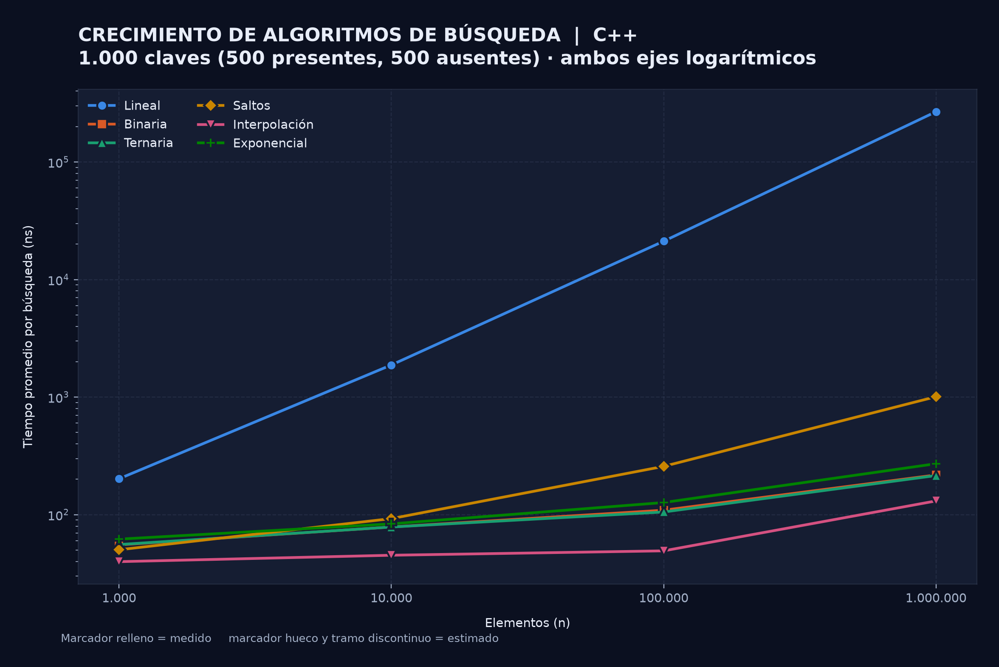
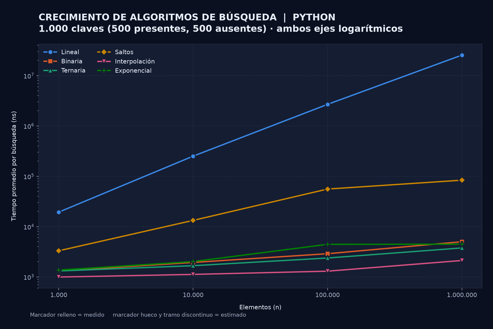
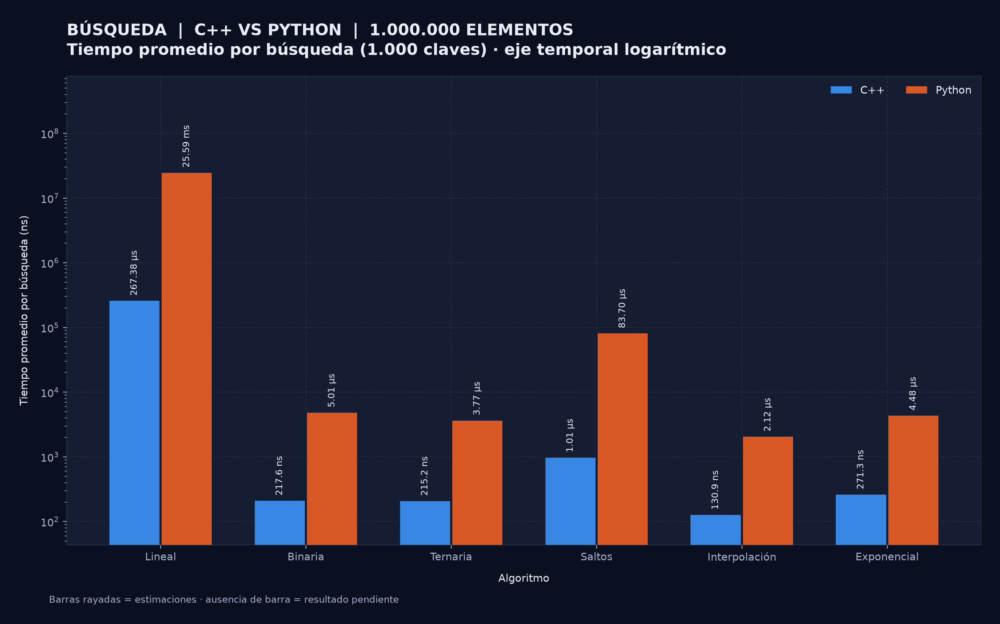

# Punto 2 Comparación experimental de algoritmos de búsqueda

## 1 Objetivo y acceso al proyecto

Se comparó el desempeño de la Búsqueda Lineal, Binaria, Ternaria, por Saltos (Jump Search), por Interpolación y Exponencial en C++ y Python. El propósito fue observar cómo cambia el tiempo promedio por búsqueda al aumentar el tamaño del arreglo, cómo influye la posición de la clave y qué diferencia produce ejecutar la misma estrategia en un lenguaje compilado y en uno interpretado. La Búsqueda Lineal se incluye como referencia: es la única que no necesita un arreglo ordenado.

**Repositorio del código:** https://github.com/Estebangmz666/sorting-algorithms-benchmark

## 2 Metodología y decisiones técnicas

### 2.1 Datos de entrada

Se utilizaron los arreglos ordenados de forma ascendente del Punto 1 (`ascending_<n>.txt`), con 1.000, 10.000, 100.000 y 1.000.000 de enteros entre 10.000.000 y 99.999.999. Ambos lenguajes leen exactamente los mismos archivos.

Las claves se generaron **una sola vez** con `dataGenerationAndValidation/generate_keys.py` y semilla fija 20261021, y se guardaron en texto plano junto a cada arreglo:

- `keys_<n>.txt`: 1.000 claves en orden aleatorio. 500 están presentes en el arreglo (valores distintos tomados de él) y 500 están ausentes (enteros de 8 dígitos dentro del mismo rango que no aparecen en el arreglo). Que las ausentes estén dentro del rango es importante: obliga a los algoritmos a recorrer el arreglo en lugar de descartarlas con una sola comparación contra los extremos.
- `position_keys_<n>.txt`: tres claves tomadas del arreglo ascendente, en los índices 0 (inicio), n/2 (centro) y n − 1 (final). Se comprobó que ninguna de las tres está repetida en su arreglo, por lo que su posición es exacta.

Como cada tamaño es un arreglo aleatorio independiente, cada n tiene su propio archivo de claves; en todos ellos se verificó que exactamente 500 claves están presentes.

### 2.2 Condiciones de medición

Cada combinación de algoritmo, lenguaje, variante y tamaño se ejecutó **cinco veces**, cada una en un proceso nuevo, igual que en el Punto 1. Dentro de cada repetición:

1. Se leen el arreglo y las claves, y se comprueba que el arreglo está ordenado (fuera del tiempo medido).
2. Se cronometran **las 1.000 búsquedas completas** con `std::chrono::steady_clock` en C++ y `time.perf_counter_ns()` en Python. Cada índice devuelto se guarda en un arreglo de resultados; en C++ esto además impide que el compilador elimine las búsquedas al optimizar.
3. Fuera del tiempo medido se verifica cada resultado: si la clave está presente (comprobado con `std::binary_search` o `bisect`), el índice devuelto debe contenerla; si está ausente, el algoritmo debe devolver −1.
4. El tiempo total se divide entre 1.000 para obtener el **tiempo promedio por búsqueda**.

Las variantes medidas son cuatro: `keys` (las 1.000 claves del archivo) y `start`, `center` y `end` (la clave de esa posición buscada 1.000 veces). Se reportan la media y la desviación estándar muestral de los cinco tiempos por búsqueda.

C++ se compiló con g++ 16.1 (MSYS2 UCRT64) usando `-std=c++17 -O2`, y Python se ejecutó con CPython 3.13.7. Ninguno de los dos usa compilación JIT, por lo que no se requirió una ejecución de calentamiento. Equipo: Intel Core i5-1135G7 (4 núcleos, L2 de 1,25 MB por núcleo, L3 de 8 MB) con 7,8 GB de RAM, Windows 11.

Los dos CSV (`results/search_results_cpp.csv` y `results/search_results_py.csv`) contienen las 192 combinaciones previstas: 6 algoritmos × 2 lenguajes × 4 variantes × 4 tamaños. **Las 192 fueron medidas**, lo que da 960 repeticiones. Ninguna se acercó al límite de 5 minutos, por lo que no fue necesario estimar ningún valor. La ejecución más larga fue la Búsqueda Lineal en Python con la clave al final y n = 1.000.000: unos 34 s por repetición. Ningún algoritmo falló la verificación.

Cada registro del CSV incluye algoritmo, lenguaje, variante, n, número de búsquedas, los cinco tiempos por búsqueda en ns, media, desviación estándar, tiempo total promedio en ms, claves encontradas, estado (medido o estimado) y método. El orquestador conserva también la lógica de estimación del Punto 1 (límite preventivo de 240 s y timeout de 300 s por repetición), aunque en esta corrida no se activó.

### 2.3 Decisiones de implementación

Las seis búsquedas siguen las versiones iterativas de GeeksforGeeks [1–6] y usan exactamente la misma lógica en ambos lenguajes. Todas reciben el arreglo y la clave, y devuelven el índice encontrado o −1.

- **Lineal:** recorre el arreglo desde el índice 0 y se detiene en la primera coincidencia.
- **Binaria:** compara con el centro `mid = low + (high − low) / 2` y descarta la mitad que no puede contener la clave.
- **Ternaria:** compara con dos puntos, `mid1 = l + (r − l)/3` y `mid2 = r − (r − l)/3`, y conserva uno de los tres tercios.
- **Por Saltos:** avanza en bloques de tamaño ⌊√n⌋ hasta encontrar un bloque cuyo último elemento sea mayor o igual que la clave, y luego lo recorre linealmente.
- **Por Interpolación:** estima la posición con `pos = low + (clave − A[low]) · (high − low) / (A[high] − A[low])`. En C++ el producto se calcula con enteros de 64 bits porque puede superar el rango de `int`. Si `A[high] = A[low]`, se compara directamente para evitar una división entre cero.
- **Exponencial:** comprueba el índice 0 y duplica un límite (1, 2, 4, …) mientras `A[límite] ≤ clave`; después aplica búsqueda binaria entre límite/2 y min(límite, n − 1).

Las pruebas `testSearchAlgorithms.cpp` y `testSearchAlgorithms.py` verifican los seis algoritmos con arreglos vacíos, de un elemento, con valores repetidos y aleatorios de hasta 1.000 elementos. Buscan cada valor, sus vecinos ±1 y claves fuera del rango.

## 3 Complejidad y requisitos de cada algoritmo

La tabla resume la complejidad temporal de referencia [1–7]. Todas las versiones utilizadas son iterativas y usan memoria auxiliar O(1).

| Algoritmo | Mejor caso | Caso promedio | Peor caso | Requisito sobre los datos |
|---|---|---|---|---|
| Lineal | Θ(1) | Θ(n) | Θ(n) | Ninguno |
| Binaria | Θ(1) | Θ(log₂ n) | Θ(log₂ n) | Arreglo ordenado |
| Ternaria | Θ(1) | Θ(log₃ n) | Θ(log₃ n) | Arreglo ordenado |
| Por Saltos | Θ(1) | Θ(√n) | Θ(√n) | Arreglo ordenado |
| Por Interpolación | Θ(1) | Θ(log log n)* | Θ(n) | Ordenado y con valores aproximadamente uniformes |
| Exponencial | Θ(1) | Θ(log i)** | Θ(log n) | Arreglo ordenado |

\* El promedio Θ(log log n) supone claves distribuidas de forma aproximadamente uniforme, que es el caso de los datos generados. Con distribuciones muy sesgadas (por ejemplo, valores que crecen exponencialmente), la posición estimada puede avanzar de a un elemento y el costo degenera a Θ(n).

\*\* i es la posición de la clave: la fase de duplicación hace ⌈log₂ i⌉ pasos y la binaria final trabaja sobre un intervalo de tamaño cercano a i/2. Para claves uniformes, i es proporcional a n y el costo es Θ(log n).

Aunque log₃ n < log₂ n, la Búsqueda Ternaria hace hasta cuatro comparaciones por iteración frente a dos de la Binaria, por lo que en número total de comparaciones no es mejor: 4/log₂3 ≈ 2,52 frente a 2 comparaciones por cada factor log₂ n. Los resultados de la sección 5 muestran que esa diferencia teórica no se traduce igual en ambos lenguajes.

## 4 Crecimiento con 1.000 claves

Las figuras 7 y 8 presentan una línea por algoritmo, con ambos ejes logarítmicos. Todos los puntos son medidos. Las tablas muestran R = T(10n)/T(n). La referencia teórica para cada intervalo (1.000 → 10.000, 10.000 → 100.000 y 100.000 → 1.000.000) es:

- lineal: 10×;
- √n: 3,16×;
- log n (Binaria, Ternaria y Exponencial): 1,33×, 1,25× y 1,20×;
- log log n (Interpolación): 1,13×, 1,09× y 1,06×.

### 4.1 Resultados de C++



**Figura 7.** Tiempo promedio por búsqueda en C++ con las 1.000 claves.

| Algoritmo | 1.000 ns | 10.000 ns | 100.000 ns | 1.000.000 ns | R₁ | R₂ | R₃ | Teoría |
|---|---|---|---|---|---|---|---|---|
| Lineal | 202,10 | 1.876,64 | 21.178,74 | 267.380,16 | 9,29× | 11,29× | 12,62× | 10× |
| Binaria | 55,40 | 78,60 | 109,16 | 217,58 | 1,42× | 1,39× | 1,99× | ≈1,2–1,3× |
| Ternaria | 55,74 | 78,54 | 105,42 | 215,16 | 1,41× | 1,34× | 2,04× | ≈1,2–1,3× |
| Por Saltos | 50,32 | 92,60 | 257,60 | 1.008,12 | 1,84× | 2,78× | 3,91× | 3,16× |
| Interpolación | 39,86 | 45,20 | 49,26 | 130,92 | 1,13× | 1,09× | 2,66× | ≈1,1× |
| Exponencial | 61,96 | 83,54 | 126,88 | 271,30 | 1,35× | 1,52× | 2,14× | ≈1,2–1,3× |

La Búsqueda Lineal siguió de cerca el factor 10 esperado (9,29×, 11,29× y 12,62×). La Interpolación coincidió casi exactamente con log log n en los dos primeros intervalos (1,13× y 1,09×). La Binaria, la Ternaria y la Exponencial crecieron algo más que la referencia logarítmica en los dos primeros intervalos, y Saltos se fue acercando a √n hasta superarlo ligeramente.

En el último intervalo, **todos los algoritmos sublineales casi duplicaron su tiempo** (entre 1,99× y 2,66×), muy por encima de lo que predice su complejidad. La causa más compatible con los datos es la jerarquía de memoria. El arreglo de 1.000.000 de `int` ocupa 4 MB: no cabe en la caché L2 de 1,25 MB del procesador y debe leerse desde la L3 o la RAM. Los arreglos menores (4 KB, 40 KB y 400 KB) sí caben en L1 o L2. Cada búsqueda binaria toca unas 20 posiciones dispersas y, con claves aleatorias, muchas de esas lecturas fallan en caché. El número de pasos sigue creciendo como log n, pero el costo de cada paso aumenta. Los CSV no miden directamente los fallos de caché, por lo que esta explicación es una interpretación basada en el tamaño de los datos y la arquitectura, no una medición.

La Lineal también creció algo más que 10× al final (12,62×) por la misma razón, aunque en menor medida: recorre memoria de forma secuencial y el prefetcher del procesador anticipa esas lecturas.

### 4.2 Resultados de Python



**Figura 8.** Tiempo promedio por búsqueda en Python con las 1.000 claves.

| Algoritmo | 1.000 ns | 10.000 ns | 100.000 ns | 1.000.000 ns | R₁ | R₂ | R₃ | Teoría |
|---|---|---|---|---|---|---|---|---|
| Lineal | 19.407,94 | 251.387,28 | 2.685.524,02 | 25.587.413,08 | 12,95× | 10,68× | 9,53× | 10× |
| Binaria | 1.321,68 | 1.941,18 | 2.895,58 | 5.013,50 | 1,47× | 1,49× | 1,73× | ≈1,2–1,3× |
| Ternaria | 1.314,26 | 1.674,12 | 2.376,92 | 3.770,74 | 1,27× | 1,42× | 1,59× | ≈1,2–1,3× |
| Por Saltos | 3.308,44 | 13.296,98 | 55.776,54 | 83.700,76 | 4,02× | 4,19× | 1,50× | 3,16× |
| Interpolación | 995,68 | 1.123,08 | 1.301,48 | 2.123,22 | 1,13× | 1,16× | 1,63× | ≈1,1× |
| Exponencial | 1.370,56 | 2.020,40 | 4.445,76 | 4.478,58 | 1,47× | 2,20× | 1,01× | ≈1,2–1,3× |

La Lineal volvió a acercarse al factor 10 (12,95×, 10,68× y 9,53×), y la Interpolación fue nuevamente la de menor crecimiento entre las que dependen de n. En Python, la Ternaria fue más rápida que la Binaria en todos los tamaños desde 10.000 (3.770,74 frente a 5.013,50 ns con un millón). Esto ocurre porque el costo dominante en el intérprete es el de cada iteración del ciclo (asignaciones, comparaciones y cálculo de índices como objetos), más que el de cada comparación aislada, y la Ternaria hace unas 12,6 iteraciones frente a unas 20 de la Binaria. En C++ las dos quedaron prácticamente empatadas (215,16 y 217,58 ns).

Dos cocientes de Python se apartan claramente de la teoría: Saltos con 1,50× y Exponencial con 1,01× en el último intervalo. Ambos dependen de la medición de 100.000 elementos, que tuvo una dispersión alta. En Saltos, las cinco repeticiones fueron de 62,4, 40,2, 55,0, 38,0 y 83,2 µs (coeficiente de variación del 33 %); en Exponencial, de 4,9, 6,2, 3,8, 3,6 y 3,7 µs (25 %). Si se toma la menor repetición de Saltos (38,0 µs), el cociente siguiente sería 2,2×. Igual que en el Punto 1, se conservaron todas las repeticiones y no se descartaron valores para mejorar la tendencia; estos dos cocientes deben interpretarse con cautela.

En general, el crecimiento de Python reproduce las tendencias teóricas con más ruido que C++. Cuando un paso cuesta del orden de cientos de nanosegundos en el intérprete, pequeñas interferencias del sistema operativo pesan más que en C++, donde un paso cuesta unos pocos nanosegundos.

## 5 C++ frente a Python

La figura 9 compara el tiempo promedio por búsqueda con 1.000.000 de elementos y las 1.000 claves. El factor es el cociente entre el promedio de Python y el de C++.



**Figura 9.** Comparación de lenguajes para n = 1.000.000.

| Algoritmo | C++ ns | Python ns | Python / C++ |
|---|---|---|---|
| Lineal | 267.380,16 ± 52.999,16 | 25.587.413,08 ± 2.149.686,44 | 95,7× |
| Binaria | 217,58 ± 19,88 | 5.013,50 ± 1.677,46 | 23,0× |
| Ternaria | 215,16 ± 41,69 | 3.770,74 ± 245,01 | 17,5× |
| Por Saltos | 1.008,12 ± 415,05 | 83.700,76 ± 4.379,91 | 83,0× |
| Interpolación | 130,92 ± 11,18 | 2.123,22 ± 436,34 | 16,2× |
| Exponencial | 271,30 ± 31,54 | 4.478,58 ± 268,74 | 16,5× |

C++ fue más rápido en los seis algoritmos, pero la ventaja no fue uniforme. Se separa en dos grupos según cuántas iteraciones hace cada búsqueda:

- **Algoritmos con muchas iteraciones** (Lineal, con cientos de miles por búsqueda, y Saltos, con unas 1.000): Python fue entre 83× y 96× más lento. Aquí el tiempo es casi solo el ciclo. En C++ cada iteración es una comparación de enteros sobre memoria contigua que el compilador optimiza, mientras que en Python cada iteración interpreta varias instrucciones de bytecode, accede a un objeto `int` a través de un puntero y compara objetos.
- **Algoritmos con pocas iteraciones** (Binaria, Ternaria, Interpolación y Exponencial, con unos 3 a 40 pasos): el factor bajó a entre 16× y 23×. En Python pesa un costo fijo por búsqueda (la llamada a la función y la preparación de variables), del orden de cientos de nanosegundos. En C++, en cambio, una parte importante de los ~200 ns se va en esperar a la memoria por fallos de caché. Esa espera no depende del lenguaje, por lo que reduce la diferencia relativa.

El orden de los algoritmos fue casi el mismo en los dos lenguajes: Interpolación fue la más rápida, seguida de la Ternaria, y Saltos y Lineal fueron las más lentas en ambos. La única diferencia está en Binaria y Exponencial. En C++ la Binaria quedó prácticamente empatada con la Ternaria y por delante de la Exponencial. En Python la Exponencial superó a la Binaria (4.478,58 frente a 5.013,50 ns), aunque la Binaria tuvo ahí una dispersión alta (± 1.677,46 ns). Como en el Punto 1, estos cocientes describen estas implementaciones, datos y equipo; no permiten afirmar un factor fijo entre lenguajes.

## 6 Efecto de la posición de la clave

Las tablas muestran el tiempo promedio por búsqueda (media ± desviación estándar de cinco repeticiones) al buscar 1.000 veces la clave ubicada al inicio, en el centro y al final del arreglo de 1.000.000 de elementos. También se encuentran en `results/search_position_tables.md`.

### 6.1 C++

| Algoritmo | Inicio | Centro | Final |
|---|---|---|---|
| Lineal | 1,96 ± 0,76 ns | 134.239,84 ± 9.293,23 ns | 368.608,48 ± 90.617,88 ns |
| Binaria | 24,04 ± 0,96 ns | 24,50 ± 1,60 ns | 26,42 ± 5,56 ns |
| Ternaria | 28,52 ± 2,49 ns | 34,42 ± 5,45 ns | 25,62 ± 0,51 ns |
| Por Saltos | 3,40 ± 0,16 ns | 482,72 ± 78,69 ns | 1.728,66 ± 815,26 ns |
| Interpolación | 3,50 ± 1,06 ns | 19,18 ± 0,49 ns | 3,54 ± 0,83 ns |
| Exponencial | 1,86 ± 0,30 ns | 27,38 ± 0,66 ns | 34,56 ± 2,22 ns |

### 6.2 Python

| Algoritmo | Inicio | Centro | Final |
|---|---|---|---|
| Lineal | 293,08 ± 107,35 ns | 17.617.332,86 ± 4.696.068,89 ns | 33.894.593,80 ± 3.797.137,30 ns |
| Binaria | 2.029,60 ± 96,83 ns | 2.405,34 ± 311,38 ns | 2.834,62 ± 763,39 ns |
| Ternaria | 2.101,90 ± 142,86 ns | 4.015,20 ± 2.151,24 ns | 2.414,36 ± 62,82 ns |
| Por Saltos | 377,86 ± 71,59 ns | 51.463,82 ± 7.147,92 ns | 200.192,78 ± 64.236,46 ns |
| Interpolación | 308,84 ± 91,11 ns | 1.979,00 ± 807,17 ns | 394,20 ± 134,96 ns |
| Exponencial | 112,84 ± 4,19 ns | 2.551,68 ± 59,37 ns | 3.379,56 ± 700,42 ns |

### 6.3 Análisis

La posición de la clave cambia el tiempo de forma drástica en los algoritmos que **recorren el arreglo desde el inicio** (Lineal, Saltos y Exponencial) y casi nada en los que **empiezan por el medio** (Binaria y Ternaria). La Interpolación es un caso aparte: depende del valor de la clave, no de su posición.

**Lineal.** Revisa los elementos en orden desde el índice 0, así que el número de comparaciones es exactamente la posición + 1: 1 al inicio, 500.001 en el centro y 1.000.000 al final. Al inicio, la búsqueda tarda 1,96 ns en C++. En Python tarda 293 ns, que corresponden casi en su totalidad al costo fijo de llamar a la función. Del centro al final, el tiempo aumentó 2,7× en C++ y 1,9× en Python, frente a 2× teórico. Los datos de la sección 4 también lo confirman: con las 1.000 claves mixtas, una clave presente recorre en promedio la mitad del arreglo y una ausente lo recorre completo, así que el costo esperado es 0,5 · 0,5n + 0,5 · n = 0,75n. Eso predice 0,75 × 33,89 ms = 25,4 ms en Python, frente a 25,59 ms medidos, y 0,75 × 368,6 µs = 276 µs en C++, frente a 267,4 µs medidos.

**Por Saltos.** Avanza de bloque en bloque desde el inicio, con bloques de 1.000 elementos. Al inicio, el primer bloque ya contiene la clave y la encuentra de inmediato. En el centro (índice 500.000), hace 500 saltos y la clave queda justo al comienzo del bloque, sin recorrido lineal. Al final (índice 999.999), hace 999 saltos y además recorre 999 elementos del último bloque: unas 1.998 operaciones frente a 500, es decir, 4×. Los tiempos medidos reproducen esa proporción: 3,6× en C++ (1.728,66 / 482,72) y 3,9× en Python (200.192,78 / 51.463,82).

**Exponencial.** Si la clave está en el índice 0, la encuentra con la primera comparación; por eso fue el algoritmo más rápido al inicio en Python (112,84 ns) y casi empató con la Lineal en C++. Para el centro necesita 19 duplicaciones (2¹⁹ = 524.288) y luego una binaria sobre unas 262.000 posiciones. Para el final necesita 20 duplicaciones y una binaria sobre un intervalo algo mayor. Por eso el final fue un poco más lento que el centro en ambos lenguajes (34,56 frente a 27,38 ns en C++, y 3.379,56 frente a 2.551,68 ns en Python). Su costo es Θ(log i): crece con la posición, pero solo logarítmicamente.

**Binaria y Ternaria.** Siempre comienzan por el centro del intervalo y lo reducen a la mitad o a un tercio. Ninguna de las tres claves coincide con el primer punto revisado: la Binaria revisa primero el índice 499.999, no el 500.000. Por eso las tres posiciones requieren un número parecido de pasos, unos 20 en la Binaria y unos 13 en la Ternaria. En C++, la Binaria quedó entre 24 y 26 ns en las tres posiciones, y en Python entre 2,0 y 2,8 µs. Las variaciones son pequeñas y del orden de su dispersión, como la de la Ternaria en el centro en Python (4.015,20 ± 2.151,24 ns).

**Interpolación.** No revisa los elementos por posición: calcula dónde *debería* estar la clave según su valor. Para la clave del inicio, que es el valor mínimo, la fórmula da exactamente `low`; para la del final, que es el máximo, da exactamente `high`. En ambos casos acierta en la primera estimación: 3,5 ns en C++ y entre 309 y 394 ns en Python. Para la del centro, la estimación cae cerca pero no exactamente, y necesita unas pocas estimaciones más: 19,18 ns en C++ y 1.979 ns en Python.

**Clave repetida frente a 1.000 claves distintas.** En C++, buscar la misma clave 1.000 veces fue mucho más rápido que buscar las 1.000 claves del archivo. Por ejemplo, la Binaria tardó unos 25 ns por búsqueda con la clave repetida frente a 217,58 ns con las claves del archivo. Al repetir la clave, las ~20 posiciones que visita la búsqueda permanecen en la caché L1 y el predictor de saltos del procesador aprende el camino, de modo que no hay fallos de caché ni predicciones erróneas. Por eso las tablas de esta sección sirven para comparar posiciones entre sí, pero no deben compararse directamente con los tiempos de la sección 4.

## 7 Dispersión y limitaciones

Ninguna combinación necesitó estimación: la más costosa tardó unos 34 s por repetición, lejos de los 5 minutos permitidos. Las mediciones de Python presentan más dispersión que las de C++; el caso más visible es Saltos con 100.000 elementos (sección 4.2). Los tiempos sublineales de C++ están en el orden de las decenas o cientos de nanosegundos por búsqueda, por lo que medir las 1.000 búsquedas juntas, como pide el taller, fue necesario para obtener valores por encima de la resolución del reloj.

Una primera corrida completa de Python se realizó mientras el equipo instalaba el compilador de C++ y mostró desviaciones anormalmente altas. Esa corrida se descartó y se repitió completa con el equipo sin otra carga. Los CSV del repositorio corresponden solo a la corrida repetida.

Los resultados dependen del equipo, del compilador y de la versión de Python indicados en la sección 2.2. La explicación de los saltos de C++ en n = 1.000.000 por la jerarquía de caché se apoya en el tamaño de los arreglos y en la arquitectura del procesador, pero no se midieron contadores de caché.

## 8 Conclusiones

El crecimiento medido reprodujo las tendencias teóricas. La Lineal aumentó cerca de 10× por cada aumento de n en 10×, Saltos se acercó a √n, y la Binaria, la Ternaria, la Exponencial y la Interpolación crecieron muy poco hasta 100.000 elementos. En C++, el paso a 1.000.000 casi duplicó el tiempo de todas las búsquedas sublineales, un efecto que la complejidad asintótica no predice y que es compatible con que el arreglo dejara de caber en la caché L2.

La Búsqueda por Interpolación fue la más rápida en ambos lenguajes porque los datos son uniformes, que es justo el supuesto que la favorece. Con datos sesgados podría degradarse hasta Θ(n). La Ternaria no fue peor que la Binaria; en Python fue más rápida porque el intérprete penaliza más las iteraciones que las comparaciones.

La posición de la clave importa en los algoritmos que avanzan desde el inicio (Lineal, Saltos y Exponencial) y apenas importa en los que empiezan por el centro (Binaria y Ternaria). Las proporciones medidas coincidieron con el número de pasos calculado a partir del código, como el factor de 4× de Saltos entre el centro y el final.

C++ fue entre 16× y 96× más rápido que Python. La diferencia fue mayor en los algoritmos con muchas iteraciones por búsqueda, donde pesa el costo del intérprete por iteración, y menor en los de pocas iteraciones, donde pesan el costo fijo de la llamada y el acceso a memoria.

## 9 Referencias

1. GeeksforGeeks. *Linear Search Algorithm*. https://www.geeksforgeeks.org/dsa/linear-search/
2. GeeksforGeeks. *Binary Search Algorithm – Iterative and Recursive Implementation*. https://www.geeksforgeeks.org/dsa/binary-search/
3. GeeksforGeeks. *Ternary Search*. https://www.geeksforgeeks.org/dsa/ternary-search/
4. GeeksforGeeks. *Jump Search*. https://www.geeksforgeeks.org/dsa/jump-search/
5. GeeksforGeeks. *Interpolation Search*. https://www.geeksforgeeks.org/dsa/interpolation-search/
6. GeeksforGeeks. *Exponential Search*. https://www.geeksforgeeks.org/dsa/exponential-search/
7. Perl, Y., Itai, A. y Avni, H. (1978). *Interpolation Search—A Log Log N Search*. Communications of the ACM, 21(7), 550–553.

**Datos experimentales:** `results/search_results_cpp.csv` y `results/search_results_py.csv`. Las figuras 7, 8 y 9 y las tablas de este informe se elaboraron a partir de esos archivos con `scripts/plotSearchResults.py`.

## 10 Reproducción

Desde la raíz del repositorio:

```powershell
# Claves (ya generadas; el script se niega a sobrescribirlas)
python dataGenerationAndValidation/generate_keys.py

# Pruebas de correctitud
python testSearchAlgorithms.py
C:\msys64\ucrt64\bin\g++.exe -std=c++17 -O2 -o testSearchAlgorithms.exe testSearchAlgorithms.cpp src/cpp/algorithms/linearSearch.cpp src/cpp/algorithms/binarySearch.cpp src/cpp/algorithms/ternarySearch.cpp src/cpp/algorithms/jumpSearch.cpp src/cpp/algorithms/interpolationSearch.cpp src/cpp/algorithms/exponentialSearch.cpp
.\testSearchAlgorithms.exe

# Worker de C++
C:\msys64\ucrt64\bin\g++.exe -std=c++17 -O2 -o src/cpp/searchWorker.exe src/cpp/benchmark/searchWorker.cpp src/cpp/algorithms/linearSearch.cpp src/cpp/algorithms/binarySearch.cpp src/cpp/algorithms/ternarySearch.cpp src/cpp/algorithms/jumpSearch.cpp src/cpp/algorithms/interpolationSearch.cpp src/cpp/algorithms/exponentialSearch.cpp

# Mediciones (reanudables: saltan las combinaciones ya medidas)
python scripts/runSearchBenchmarks.py --language cpp
python scripts/runSearchBenchmarks.py --language py

# Gráficas y tablas por posición (requiere matplotlib y numpy)
python scripts/plotSearchResults.py

# Dashboard interactivo de búsqueda (solo biblioteca estándar)
python scripts/buildSearchDashboard.py
start charts\search_dashboard.html
```

El dashboard `charts/search_dashboard.html` es un único archivo autónomo que funciona sin internet. Permite comparar dos series (algoritmo y lenguaje) o explorar varias a la vez, cambiar la variante de claves y el tamaño, ver la comparación C++/Python, la tabla por posición de la clave y las cinco repeticiones de cada punto. Toma el estilo visual del dashboard del Punto 1.

## Uso de inteligencia artificial (Punto 2)

Se utilizó Claude Code (Anthropic) como asistente en la implementación de los seis algoritmos de búsqueda en C++ y Python a partir de las versiones de GeeksforGeeks, en la escritura de los workers de medición, el orquestador, las pruebas y el script de gráficas, y en la redacción de un borrador de este informe a partir de los CSV generados. Los resultados provienen de ejecuciones reales en el equipo descrito. Este apartado debe integrarse en la sección final de inteligencia artificial del documento de entrega.
